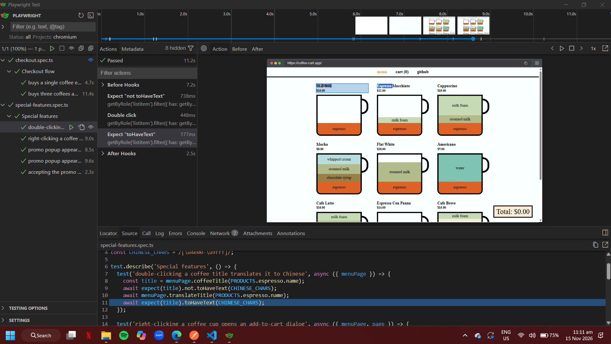
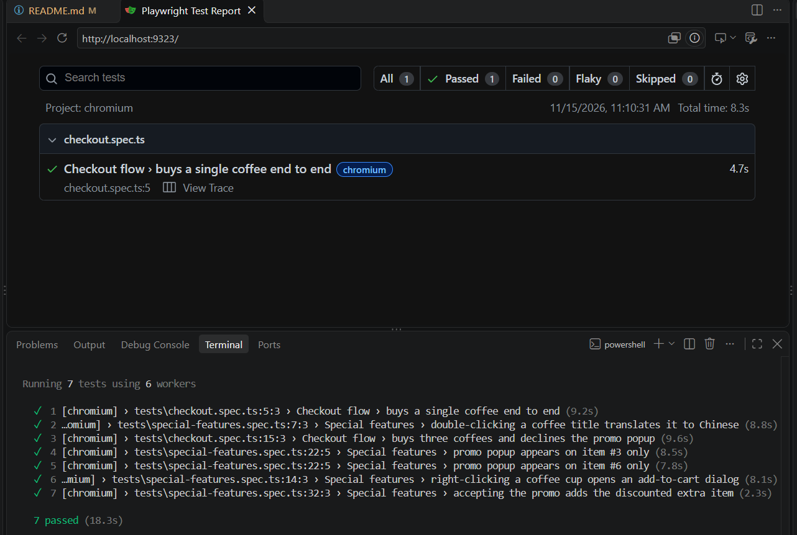

# Coffee Cart Playwright Automation Framework

An enterprise-grade End-to-End (E2E) UI testing framework built with Playwright and TypeScript, designed using scalable design patterns (Page Object Model and Fixtures) for clean maintenance and CI/CD integration.

## Architecture & Design Patterns
- **Page Object Model (POM):** Encapsulates page locators and user interactions separately from test logic (`src/pages`).
- **Playwright Fixtures:** Manages browser setup, context isolation, and clean state teardown per test (`src/fixtures`).
- **Test Data Isolation:** Test data and payload factories are strictly separated from test flows (`src/data`).
- **Resilient Locators:** Utilizes strict web-first assertions and user-facing locators (`getByRole`, `getByLabel`, `getByTestId`), eliminating arbitrary sleeps.

## Features Automated
1. **End-to-End Checkout:** Add coffee → Handle promo popup → Checkout → Submit payment details → Verify success message.
2. **Promo Popup Logic:** Verifies dynamic promo triggers on every 3rd item (milestones 3 and 6), with test scenarios for both accepting and declining the promotion.
3. **Special Features:** 
   - Double-clicking coffee titles to trigger Chinese translation.
   - Right-clicking coffee cups to open custom add-to-cart dialogs.

## Test Execution Evidence

### Local Playwright Test Runner (7/7 Passed)


### GitHub Actions CI/CD Pipeline Execution


## Getting Started & Execution

1. **Install Dependencies:**
   ```bash
   npm ci
   npx playwright install chromium
